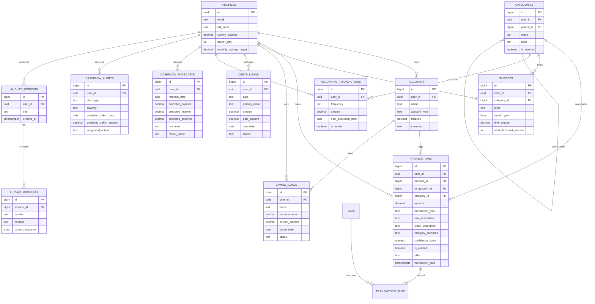

# BÁO CÁO KẾ HOẠCH TRIỂN KHAI ĐỀ TÀI VÀ ĐẶC TẢ HỆ THỐNG

Thiết lập giọng nói sau khi clone: [tải Model 3 từ GitHub Release](docs/MODEL3_SETUP.md).
Thiết lập classifier sau khi clone: [tải PhoBERT cho Model 1](backend/app/infrastructure/ai/classifier/README.md#setup-after-cloning-no-training).

Kiến trúc đích và fallback Model 1/3/4: [đặc tả hệ thống, mục 5](docs/SPECIFICATION.md#5-thiết-kế-kiến-trúc-hệ-thống-và-4-mô-hình-ai), [ADR 0004](docs/adr/0004-three-tier-ai-and-modality-fallback.md), [GitHub #52](https://github.com/Drista4real/Project1/issues/52). Phần 5.6 của đặc tả phân biệt thiết kế với tính năng đã triển khai.
## Đề tài 17: Hệ thống Quản lý Tài chính Cá nhân Dự báo Dòng tiền Thông minh (AI-driven Cash Flow Forecasting & Financial Management)

---

## 1. TỔNG QUAN DỰ ÁN (PROJECT OVERVIEW)

### 1.1. Bối cảnh & Vấn đề thực tế
Quản lý tài chính cá nhân là nhu cầu thiết yếu đối với người đi làm và sinh viên. Tuy nhiên, các giải pháp hiện nay trên thị trường (Money Lover, Spendee, Sổ Thu Chi...) đều tồn tại ba rào cản lớn:
1. **Nút thắt nhập liệu thủ công:** Người dùng phải tự tay nhập số tiền, chọn danh mục chi tiêu cho từng giao dịch. Hành vi chuyển khoản ngân hàng thường có nội dung ngắn gọn, không dấu hoặc viết tắt khiến việc tự động hóa gặp khó khăn.
2. **Thiếu khả năng nhìn về tương lai (Reactive vs. Proactive):** Hầu hết các ứng dụng chỉ thống kê lịch sử quá khứ ("tháng này đã tiêu bao nhiêu"), không thể trả lời câu hỏi cốt lõi: *"Với tốc độ chi tiêu này, liệu 10-20 ngày tới tài khoản có bị thâm hụt trước khi nhận lương không?"*.
3. **Chi phí & Độ trễ tích hợp AI:** Việc phụ thuộc hoàn toàn vào các mô hình ngôn ngữ lớn trên đám mây (Cloud LLMs như OpenAI GPT-4, Google Gemini) cho mọi tác vụ gán nhãn giao dịch gây ra độ trễ cao (>1-2s), chi phí đắt đỏ và dễ chạm giới hạn tần suất (rate-limit).

### 1.2. Giải pháp đề xuất: Kiến trúc Hybrid AI & Hệ thống Bất đồng bộ
Hệ thống giải quyết bài toán bằng cách kết hợp:
* **Kiến trúc AI phân tầng (Tiered Hybrid AI):**
  * *Tầng 1 — Client / On-device:* Flutter chạy Model 3 PhoWhisper-tiny INT8 qua sherpa-onnx để phiên âm offline, chuẩn hóa cơ bản và review; SQLCipher/Optimistic UI theo thiết kế đích.
  * *Tầng 2 — Backend CPU:* FastAPI điều phối; Model 1 PhoBERT + LightGBM phân loại text/transcript; Model 2 LightGBM/EWMA tính dòng tiền, runway và safe-to-spend; Redis/Celery cho tác vụ nặng.
  * *Tầng 3 — Cloud GPU & Foundation API:* Model 4 Qwen Document VLM đọc hóa đơn thành JSON kèm danh mục; Gemini cung cấp fallback theo tác vụ và Advisor của Model 2. Model/version cấu hình riêng, không cố định một phiên bản cho mọi đầu vào.
* **Fallback tự động chạy ngầm ở mọi model:** Model 1 → Gemini phân loại text khi thiếu tự tin; Model 3 → Gemini hỗ trợ audio khi phiên âm lỗi hoặc không đạt kiểm tra chất lượng; Model 4 → Gemini multimodal đọc lại ảnh khi Qwen thất bại; Advisor → mẫu cục bộ khi cloud lỗi. Không có nút gọi Gemini hoặc xác nhận cho từng fallback. Hóa đơn đã có danh mục hợp lệ không bắt buộc qua Model 1. Sửa/thu lại/nhập tay là phục hồi khi luồng tự động không xử lý được; review trước lưu vẫn giữ nguyên.
* **Bộ điều phối fallback chung tại backend:** Chọn text/audio/ảnh theo công đoạn lỗi. Luồng giọng nói chính là PhoWhisper → Model 1; điểm phân loại thấp chỉ gọi Gemini bằng text. Fallback audio ban đầu dùng lỗi runtime/transcript rỗng; chỉ mở rộng kiểm tra chất lượng sau khi có tín hiệu được kiểm chứng. Qwen dùng điều kiện lỗi/timeout, phản hồi bị cắt, schema và số học thay vì confidence tự khai. Khi Gemini đã nhận audio/ảnh, có thể gộp trích xuất và phân loại trong một request; đủ dữ liệu, danh mục và đạt kiểm định thì chuyển review, không gọi cloud phân loại lần nữa. Đường gộp cần đánh giá trước khi bật; mọi nhánh dùng chung ngân sách gọi cloud. Chi tiết tại [mục 5.5](docs/SPECIFICATION.md#55-ma-trận-fallback-theo-công-đoạn).
* **Hiện trạng:** demo Streamlit có fallback Gemini tự động cho Model 1/3/4 với ngân sách một lần gọi mỗi lượt phân tích. Phần đấu nối fallback media với Flutter/FastAPI để giai đoạn sau; API/app hiện có được giữ nguyên. Model 2/Advisor giữ nguyên. Request media gộp phân loại, quality gate ASR nâng cao, SQLCipher và hàng đợi media còn cần triển khai/kiểm chứng. Các chỉ tiêu độ trễ/chất lượng trong đặc tả là mục tiêu nghiệm thu. Xem [hướng dẫn demo](frontend/STREAMLIT_DEMO.md).
* **Hạ tầng Dữ liệu & Backend Hiện đại (Supabase & PostgreSQL):**
  * Sử dụng **Supabase Cloud (PostgreSQL)** làm cơ sở dữ liệu chính: hỗ trợ Row Level Security (RLS) bảo mật tuyệt đối cho dữ liệu tài chính từng người dùng, Realtime subscriptions, Auth đa phương thức và Auto-generated RESTful APIs.
* **Đa nền tảng (Cross-platform Flutter App):**
  * Ứng dụng client phát triển trên **Flutter (Dart)** hỗ trợ mượt mà trên Mobile (Android, iOS) và Web với kiến trúc Module hóa (Feature-first).

---

## 2. KẾ HOẠCH THỰC HIỆN CHI TIẾT THEO GIAI ĐOẠN

```
                  ┌─────────────────────────────────────────────────────────┐
                  │                 GIAI ĐOẠN 1: GIỮA KỲ                    │
                  │        Nghiên cứu, Huấn luyện & Bàn giao AI             │
                  └───────────────────────────┬─────────────────────────────┘
                                              │ Pipeline, Weights, Evaluated Models
                                              ▼
                  ┌─────────────────────────────────────────────────────────┐
                  │                 GIAI ĐOẠN 2: CUỐI KỲ                    │
                  │       Đóng gói App Flutter, Supabase & AI Backend       │
                  └─────────────────────────────────────────────────────────┘
```

### 2.1. GIAI ĐOẠN 1: GIỮA KỲ (Nghiên cứu & Thực nghiệm Mô hình AI)
* **Dataset:** Xây dựng tập dữ liệu 5,000 - 10,000 giao dịch ngân hàng thực tế (sao kê MBBank, Vietcombank, Techcombank...). Chuẩn hóa teencode, viết tắt, danh mục 8-10 nhóm chi tiêu.
* **NLP Model:** Kiến trúc chính Model 1 dùng PhoBERT + LightGBM, mục tiêu Macro F1 $\ge 88\%$, fallback Gemini khi `P_class < 0.8`. PhoBERT + LoRA là nhánh thực nghiệm tùy chọn, không thay đổi kiến trúc chính.
* **Time-Series Forecasting:** Model 2 dùng LightGBM Regressor cho nhóm thu nhập cố định và EWMA cho nhóm linh hoạt, dự báo 7–30 ngày. ARIMA/LSTM/DLinear chỉ là phương án so sánh nghiên cứu.

### 2.2. GIAI ĐOẠN 2: CUỐI KỲ (Hệ thống Flutter App & Supabase BaaS)
* **Frontend:** Ứng dụng Flutter trực quan: Dashboard tài chính, quản lý thu/chi, cảnh báo thâm hụt và biểu đồ dự báo.
* **Database & BaaS:** Supabase PostgreSQL với đầy đủ RLS, Functions và Edge Triggers.
* **AI Service:** Tích hợp API dự báo dòng tiền và trợ lý tài chính thông minh Gemini.

---

## 3. THIẾT KẾ CƠ SỞ DỮ LIỆU & KIẾN TRÚC DỮ LIỆU (POSTGRESQL & SUPABASE)

Cơ sở dữ liệu được triển khai trực tiếp trên **Supabase PostgreSQL** với mô hình quan hệ chuẩn hóa và bảo mật đa tầng bằng **Row Level Security (RLS)**:



### Các phân hệ dữ liệu chính (13 Bảng & 3 Analytics Views):
1. **Phân hệ Core & Tài khoản:**
   * `public.profiles`: Thông tin cá nhân, cài đặt tiền tệ, ngày nhận lương (`payroll_day`), mục tiêu tiết kiệm, giờ nhắc nhở.
   * `public.accounts`: Đa tài khoản/ví tiền (Tiền mặt, Ngân hàng MB/VCB, Ví MoMo, Thẻ tín dụng, Đầu tư) với số dư và hạn mức riêng.
2. **Phân hệ Thu/Chi & Phương pháp Kakeibo:**
   * `public.categories`: Danh mục hỗ trợ đa cấp (Cha - Con) và tích hợp 4 trụ cột Kakeibo Nhật Bản (*Thiết yếu - Needs, Mong muốn - Wants, Văn hóa - Culture, Dự phòng - Unexpected*).
   * `public.transactions`: Lịch sử giao dịch thu, chi, và chuyển khoản giữa các ví. Lưu trữ dữ liệu sao kê SMS gốc, kết quả tiền xử lý NLP và gán nhãn PhoBERT/Gemini.
   * `public.tags` & `public.transaction_tags`: Quản lý hashtag sự kiện (#dulich, #damcuoi, #quatet...).
3. **Phân hệ Kế hoạch Tài chính:**
   * `public.budgets`: Quản lý hạn mức chi tiêu theo tháng, theo danh mục hoặc theo trụ cột Kakeibo với ngưỡng cảnh báo động.
   * `public.saving_goals`: Heo đất / Hũ tiết kiệm tích lũy cho mục tiêu cụ thể (quỹ khẩn cấp, mua sắm lớn...).
   * `public.debts_loans`: Sổ ghi nợ và cho vay, theo dõi kỳ hạn thanh toán và nhắc nợ.
   * `public.recurring_transactions`: Quản lý hóa đơn định kỳ, thuê bao tháng (tiền nhà, internet, gym...).
4. **Phân hệ AI Dự báo & Trợ lý Thông minh:**
   * `public.cashflow_forecasts`: Lưu chuỗi dự báo số dư 7–30 ngày từ Model 2 (LightGBM/EWMA theo phân khúc); khoảng tin cậy cần phương pháp và đánh giá riêng.
   * `public.cashflow_alerts`: Cảnh báo nguy cơ thâm hụt số dư trước ngày nhận lương kèm hành động đề xuất.
   * `public.ai_consultations`, `public.ai_chat_sessions`, `public.ai_chat_messages`: Hệ thống lưu trữ phiên tư vấn tài chính thông minh của Google Gemini AI kèm snapshot tài chính.
   * `public.notes`: Bảng kiểm tra kết nối nhanh giữa Flutter và PostgreSQL.

### Tối ưu hóa hiệu năng & Tự động hóa (Automation & Performance):
* **Tối ưu RLS Policies:** Sử dụng biểu thức `(SELECT auth.uid())` giúp Postgres cache kết quả phiên đăng nhập, tăng tốc độ truy vấn từ 10x đến 100x.
* **Tự động hóa Trigger nghiệp vụ:**
  * `trg_sync_transaction_balance`: Tự động cộng/trừ số dư ví (`accounts.balance`) và đồng bộ về tổng tài sản (`profiles.current_balance`) mỗi khi thêm/sửa/xóa giao dịch hoặc chuyển ví.
  * `on_auth_user_created`: Tự động tạo hồ sơ profile và ví mặc định "Ví Tiền Mặt" ngay khi người dùng đăng ký tài khoản.
  * `handle_updated_at`: Tự động cập nhật mốc thời gian sửa đổi cho tất cả các bảng.
* **Đánh chỉ mục (Indexing):** Toàn bộ khóa ngoại và các trường thời gian / trạng thái thường xuyên lọc (`user_id`, `transaction_date`, `pillar`, `status`) đều được lập B-Tree Indexes tối ưu.
* **Analytics Views:** Cung cấp sẵn các view báo cáo: `v_current_month_spending_by_category`, `v_kakeibo_monthly_summary`, `v_monthly_budget_progress`.

> [!TIP]
> Toàn bộ script DDL, triggers, indexes và RLS policies đầy đủ được lưu trữ tại: [`supabase/schema.sql`](file:///d:/Project1/supabase/schema.sql). Bạn có thể sao chép và dán trực tiếp vào **SQL Editor** trên Supabase Dashboard để kích hoạt ngay.

---

## 4. CẤU TRÚC KHO CHỨA MÃ NGUỒN (REPOSITORY STRUCTURE)

Dự án được cấu trúc theo mô hình **Feature-Driven Architecture** chuẩn mực cho ứng dụng Flutter và dịch vụ backend Supabase:

```text
Project1/
├── .agents/                          # Agent skills & workflows
├── android/                          # Cấu hình Native Android
├── ios/                              # Cấu hình Native iOS
├── web/                              # Cấu hình Web App
├── supabase/                         # Database Migration & Schema
│   └── schema.sql                    # Script DDL PostgreSQL & RLS Policies
├── lib/
│   ├── core/
│   │   ├── constants/
│   │   │   └── supabase_config.dart  # URL, API Keys & Supabase Client
│   │   ├── theme/
│   │   │   └── app_theme.dart        # Bảng màu tài chính & Typography (Material 3)
│   │   └── utils/
│   ├── models/
│   │   ├── category_model.dart       # Data model danh mục thu/chi
│   │   └── transaction_model.dart    # Data model giao dịch tài chính
│   ├── services/
│   │   └── supabase_service.dart     # Service đóng gói các câu lệnh truy vấn PostgreSQL
│   ├── features/
│   │   ├── dashboard/                # Màn hình tổng quan số dư, biểu đồ và kiểm tra kết nối
│   │   │   └── dashboard_screen.dart
│   │   ├── transactions/             # Quản lý nhập liệu, danh sách thu/chi
│   │   └── forecast/                 # Trực quan hóa dự báo dòng tiền
│   ├── supabase_config.dart          # Export tương thích cấu hình
│   └── main.dart                     # Điểm khởi chạy ứng dụng (Entry point)
├── test/
│   └── widget_test.dart              # Kiểm thử Widget tự động
├── pubspec.yaml                      # Khai báo thư viện (supabase_flutter, etc.)
└── README.md                         # Báo cáo đề tài & hướng dẫn dự án
```

---

## 5. HƯỚNG DẪN CÀI ĐẶT & CHẠY ỨNG DỤNG (GETTING STARTED)

### 5.1. Yêu cầu môi trường
* **Flutter SDK:** $\ge 3.24.0$ (Đã kiểm tra trên Flutter 3.41.x & Dart 3.11.x)
* **Tài khoản Supabase:** Miễn phí tại [supabase.com](https://supabase.com)

### 5.2. Các bước thiết lập

#### 1. Khởi tạo Database trên Supabase
1. Vào [Supabase Dashboard](https://supabase.com/dashboard) -> Tạo project mới.
2. Vào mục **SQL Editor**, dán toàn bộ nội dung từ file [`supabase/schema.sql`](file:///d:/Project1/supabase/schema.sql) và nhấn **Run** để khởi tạo cấu trúc bảng và RLS.

#### 2. Cấu hình Khóa API
Mở file [`lib/core/constants/supabase_config.dart`](file:///d:/Project1/lib/core/constants/supabase_config.dart) và đảm bảo các thông số chính xác:
```dart
class SupabaseConfig {
  static const String supabaseUrl = 'https://syjigvtyxfkmmqipxufm.supabase.co';
  static const String supabaseAnonKey = 'sb_publishable_gexOlWlrEdiPuyda9jixOA_cujZIIOX';
  ...
}
```

#### 3. Chạy ứng dụng
Cài đặt thư viện và khởi chạy trên Chrome hoặc Thiết bị mô phỏng:
```bash
# Tải các dependencies
flutter pub get

# Chạy ứng dụng (trên Chrome Web hoặc Device)
flutter run -d chrome
```

---

## 6. BẢNG PHÂN BỔ NHIỆM VỤ THỰC HIỆN TRONG NHÓM

| Thành viên | Trách nhiệm chính | Giai đoạn 1 (Giữa kỳ) | Giai đoạn 2 (Cuối kỳ) |
| :--- | :--- | :--- | :--- |
| **Thành viên 1** | Team Lead & AI Engineer | Xây dựng dataset, PhoBERT embedding + LightGBM phân loại giao dịch | Tích hợp fallback Model 1/3/4 theo tác vụ & API AI |
| **Thành viên 2** | Time-Series & Data Pipeline | Tiền xử lý chuỗi thời gian, LightGBM/EWMA theo phân khúc | Đóng gói dự báo 7–30 ngày và nhánh AI Advisor của Model 2 |
| **Thành viên 3** | Backend & Database (Supabase) | Thiết kế Data Schema, đặc tả quan hệ thực thể | Triển khai PostgreSQL trên Supabase, viết RLS, Indexes |
| **Thành viên 4** | Mobile/Web Frontend (Flutter) | Thiết kế Wireframe giao diện, luồng người dùng | Xây dựng Flutter UI/UX, tích hợp Supabase SDK & Charts |

---

## 7. TIÊU CHÍ NGHIỆM THU (ACCEPTANCE CRITERIA)

* **NLP Model:** PhoBERT + LightGBM đạt Macro F1 $\ge 88\%$; mục tiêu inference CPU <15 ms, cần đo cả pipeline và công bố cấu hình benchmark.
* **Time-Series:** Đánh giá LightGBM/EWMA theo phân khúc và rolling-origin; mục tiêu MAE <300.000 VND, MAPE <10% theo đặc tả, ghi rõ cách xử lý giá trị thực bằng/tiệm cận 0.
* **Fallback:** Kiểm tra riêng lỗi phiên âm, đọc hóa đơn và phân loại; lỗi cloud giữ nháp để người dùng sửa. Schema hợp lệ không thay thế kiểm tra số học/nội dung; không tự lưu hoặc ghi đè dữ liệu đã xác nhận.
* **Hệ thống Frontend & Backend:** Ứng dụng Flutter tương tác mượt mà với cơ sở dữ liệu Supabase PostgreSQL, bảo mật phân quyền theo từng User ID, phản hồi thời gian thực và đồng bộ dữ liệu đa nền tảng.
