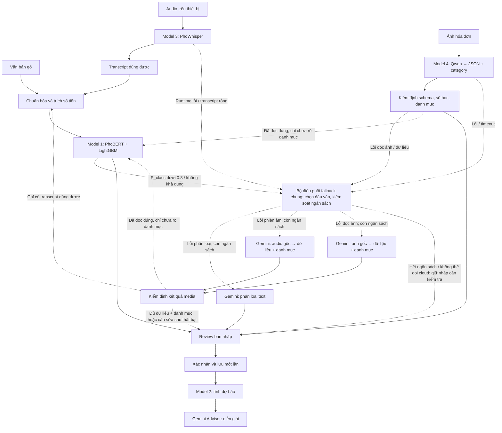

# TÀI LIỆU ĐẶC TẢ YÊU CẦU HỆ THỐNG & THIẾT KẾ KIẾN TRÚC
**Dự án:** Multimodal Personal Finance Management (Hybrid AI PFM)

**Cập nhật kiến trúc:** 2026-10-18 — [đặc tả #52](https://github.com/Drista4real/Project1/issues/52), [ADR 0004](adr/0004-three-tier-ai-and-modality-fallback.md). Đây là kiến trúc đích; đối chiếu phần 5.6 để biết giới hạn triển khai hiện tại. Các chỉ tiêu hiệu năng/chất lượng bên dưới là mục tiêu nghiệm thu, chưa phải kết quả đo.

**Hiệu chỉnh yêu cầu fallback:** [#53](https://github.com/Drista4real/Project1/issues/53) — mọi fallback ở mọi model tự động xử lý ngầm; không có nút gọi Gemini hoặc hộp thoại xác nhận từng lần fallback.

**Phương án điều phối đã chốt:** [#56](https://github.com/Drista4real/Project1/issues/56) — backend chọn text/audio/ảnh theo công đoạn lỗi, dùng chung ngân sách cloud và tránh phân loại cloud lần hai khi kết quả đa phương thức đã đầy đủ, đạt kiểm định.

---

## 1. YÊU CẦU HỆ THỐNG

### 1.1. Yêu cầu Chức năng (Functional Requirements - FR)
- **FR1 - Quản lý tài khoản & Onboarding:**
  - Xác thực một chạm qua Google Sign-In hoặc Apple ID (cấp phát JWT ngầm).
  - Hỗ trợ chế độ khách (Guest Mode) sử dụng định danh thiết bị (`Device_UUID`) để trải nghiệm tức thì.
  - Phân luồng hồ sơ dòng tiền ngay lần đầu mở app: **Thu nhập cố định** hoặc **Thu nhập linh hoạt**.
- **FR2 - Quản lý nguồn tiền & Thu/Chi định kỳ:**
  - Khởi tạo, cập nhật số dư các ví tài chính (Tiền mặt, Ngân hàng, Ví điện tử).
  - Thiết lập các mốc thu/chi định kỳ hàng tháng (ngày nhận lương, hạn đóng tiền trọ, hóa đơn tiện ích) phục vụ làm biến ngoại sinh cho mô hình dự báo.
- **FR3 - Tiếp nhận dữ liệu Đa phương thức (Multimodal Ingestion):**
  - *Văn bản tự nhiên:* Tự động chuẩn hóa từ lóng tiếng Việt ("k", "cành", "củ rưỡi") và trích xuất số tiền, nội dung.
  - *Giọng nói (Voice-to-Transaction):* Luồng chính là Model 3 phiên âm on-device → transcript dùng được → chuẩn hóa → Model 1; thiếu tự tin phân loại thì chỉ fallback text. Phiên âm lỗi/transcript rỗng tự fallback bằng audio gốc; quality gate nâng cao chỉ bật sau kiểm chứng. Gemini nhận audio có thể trả cả dữ liệu và danh mục trong một request; nếu đầy đủ và đạt kiểm định thì chuyển review, không bắt buộc phân loại lần nữa. Chỉ yêu cầu sửa/thu lại khi luồng tự động không giải quyết được.
  - *Thị giác hóa đơn (Receipt Document Understanding):* Model 4 đọc ảnh thành JSON gồm điểm bán, ngày, mặt hàng, tổng tiền và danh mục; kiểm định trước khi hiển thị. Fallback đọc ảnh dùng ảnh gốc; chỉ chuyển qua Model 1 nếu dữ liệu đã đọc đúng nhưng chưa rõ danh mục.
  - *Giao diện xác thực nhanh (Review Pop-up):* Hiển thị bảng tóm tắt thực thể để người dùng xác nhận hoặc sửa nhanh trước khi lưu sổ.
- **FR4 - Tự động phân loại giao dịch phân tầng (Hybrid Tiered Classification):**
  - Tự động gán nhãn danh mục MECE bằng Model 1 tại server CPU (Tầng 2), mục tiêu độ trễ < 15ms; không coi toàn bộ PhoBERT pipeline đã đạt mục tiêu khi chưa benchmark.
  - Tự động chuyển các giao dịch có độ không chắc chắn cao (P < 0.8) sang hàng đợi để Foundation LLM (Gemini) xử lý ngầm.
  - Yêu cầu đầu ra theo JSON Schema: XGrammar khi tự phục vụ bằng runtime hỗ trợ, Structured Outputs khi provider hỗ trợ; mọi phản hồi đều phải qua kiểm định backend. Đúng schema không đồng nghĩa đọc đúng số tiền hay phân loại đúng.
- **FR5 - Dự báo dòng tiền thích ứng & Cố vấn tài chính AI:**
  - Ngoại suy số dư trong 7 đến 30 ngày tiếp theo bằng mô hình chuỗi thời gian chuyên biệt cho từng phân khúc người dùng.
  - Tự động phân tích nguy cơ lệch pha dòng tiền hoặc thâm hụt số dư (Burn Rate vượt ngưỡng) để sinh thẻ cảnh báo sớm và đưa ra hạn mức chi tiêu an toàn (*Safe-to-spend*).
- **FR6 - Báo cáo & Trực quan hóa số liệu:**
  - Hiển thị biểu đồ tròn tỷ trọng chi tiêu (Donut Chart) và biểu đồ chuỗi thời gian liên tục từ số dư thực tế trong quá khứ sang đường nét đứt dự báo tương lai.

### 1.2. Yêu cầu Phi chức năng (Non-Functional Requirements - NFR)
- **NFR1 - Hiệu năng & Độ trễ (Performance & Latency):**
  - *Phân hệ giọng nói cục bộ:* Tốc độ phiên âm đạt RTF < 0.2; độ trễ câu 3 giây không vượt quá 350ms trên thiết bị.
  - *Tầng phân loại văn bản nhanh:* Thời gian suy luận phân loại tại CPU đạt dưới 15ms.
  - *Phản hồi giao diện người dùng:* Mọi thao tác lưu giao dịch phải cập nhật tức thì trên giao diện trong vòng dưới 100ms (Optimistic UI Update); các tác vụ AI nặng bắt buộc chạy ngầm bất đồng bộ.
  - *Bóc tách hóa đơn:* Thời gian trích xuất qua VLM không vượt quá 1.600ms.
- **NFR2 - Khả năng chịu tải & Mở rộng (Scalability):**
  - Tầng API (FastAPI) đáp ứng thông lượng tối thiểu 500 RPS.
  - Vượt qua bài kiểm thử tải (Stress-test) 300 người dùng đồng thời qua Locust với tỷ lệ lỗi HTTP 5xx duy trì ở mức 0%.
- **NFR3 - Khả năng chịu lỗi & Đảm bảo toàn vẹn cấu trúc (Robustness & Fault Tolerance):**
  - Không chấp nhận phản hồi AI sai schema vào luồng lưu; lỗi cú pháp/kiểu dữ liệu phải bị phát hiện và chuyển retry/fallback hoặc yêu cầu kiểm tra.
  - Các tác vụ gọi Cloud LLM/VLM khi gặp rate-limit hoặc mất mạng phải được lưu an toàn trong hàng đợi Redis/Celery với cơ chế Exponential Backoff (tối đa 3 lần).
  - Phân biệt lỗi phân loại (Model 1), phiên âm (Model 3) và đọc ảnh (Model 4) theo mục 5.5. Không dùng một ngưỡng `P < 0.8` chung cho cả ba. Hết retry giữ bản nháp chờ sửa; tác vụ phải có khóa chống trùng và không ghi đè chỉnh sửa người dùng.
- **NFR4 - Chỉ số Chất lượng Mô hình AI (AI Metrics):**
  - *ASR tiếng Việt:* Tỷ lệ lỗi từ WER < 6% trên tập kiểm thử giao dịch tiếng Việt.
  - *Phân loại giao dịch (Local Model):* Macro F1-Score tối thiểu đạt 88% trên tập kiểm thử.
  - *Tỷ lệ giải quyết nội bộ:* Tối thiểu 75% số lượng giao dịch thông thường được xử lý hoàn tất tại tầng cục bộ (P >= 0.8) mà không cần gọi Cloud LLM.
  - *Sai số dự báo dòng tiền:* MAE < 300.000 VND, MAPE < 10% trên chuỗi 30 ngày.
- **NFR5 - Đóng gói, Tính di động & Tối ưu Phần cứng (Portability & Edge Optimization):**
  - Model 3 on-device dùng ONNX INT8; đo dung lượng/RAM theo bản tiny/base và thiết bị đích. Bộ tiny đang phân phối khoảng 104 MB, nên không coi đã đạt mốc dưới 100 MB. Model 1 chạy server CPU, có ngân sách tài nguyên riêng; không áp giới hạn bộ ASR cho PhoBERT.
  - Toàn bộ backend, Celery workers, Redis, PostgreSQL và inference service được đóng gói đồng bộ qua Docker Compose.
- **NFR6 - An toàn & Quyền riêng tư Dữ liệu (Privacy & Security):**
  - Âm thanh được phiên âm trên thiết bị mặc định; văn bản gõ/transcript được gửi Tầng 2 để phân loại. Thiết lập quyền/chính sách xử lý cloud trước khi dùng tính năng, nêu rõ audio có thể tự động được gửi lên cloud khi ASR lỗi/không đạt chất lượng và ảnh hóa đơn được xử lý tại Tầng 3; không hỏi lại ở từng fallback. Giữ audio tạm đến khi pipeline hoàn tất, quy định thời hạn giữ/xóa media. Nếu thiếu quyền hoặc mất mạng thì trả trạng thái cần kiểm tra thay vì mở hộp thoại gọi Gemini.
  - Toàn bộ kênh truyền được mã hóa qua TLS 1.3 (HTTPS/WSS).
  - Database cục bộ trên client mã hóa bằng SQLCipher; xác thực người dùng bằng cặp khóa JWT.

---

## 2. MÔ TẢ CHI TIẾT CÁC PHÂN HỆ CHỨC NĂNG

### 2.1. Nhập liệu Đa phương thức Tiên tiến (Multimodal Ingestion)
- **Gõ văn bản tự nhiên:** Nhập câu khẩu ngữ (ví dụ: *"highland cf 55k"*, *"bún bò 40 cành"*, *"đóng tiền nhà 3 củ rưỡi"*). Hệ thống bóc tách số tiền, quy đổi tiếng lóng và gán danh mục tự động.
- **Xử lý âm thanh khẩu ngữ (Edge Voice-to-Text):** Bấm giữ micro để nói (ví dụ: *"vừa đổ năm mươi nghìn tiền xăng"*). Mô hình ASR nhúng trên thiết bị biên dịch trực tiếp sóng âm thành văn bản offline không cần mạng.
- **Thị giác tài liệu hóa đơn (Document VLM):** Chụp ảnh hóa đơn bán lẻ hoặc ảnh chụp màn hình chuyển khoản. VLM đọc trực tiếp ảnh thô, phân tích bảng biểu và trích xuất cây dữ liệu JSON chứa tên quán, danh sách món, đơn giá và tổng tiền.

### 2.2. Dự báo Dòng tiền Thích ứng & Trợ lý Cố vấn AI
- **Ngoại suy số dư đa chu kỳ:** Dùng mô hình học máy chuỗi thời gian tính toán đường đi của số dư tài khoản trong 7 đến 30 ngày kế tiếp dựa trên lịch sử dòng tiền và biến ngoại sinh.
- **Cảnh báo sớm lệch pha dòng tiền:**
  - Nhóm Cố định: Quét nguy cơ số dư bị âm trước ngày nhận lương tiếp theo để phát cảnh báo lệch pha dòng tiền.
  - Nhóm Linh hoạt: Tính toán chỉ số Runway (số ngày sống sót) và hạn mức an toàn mỗi ngày (*Safe-to-spend*).

### 2.3. Quản lý Nguồn tiền & Cập nhật Trạng thái Tức thì (Optimistic UI)
- Quản lý tập trung các ví: Tiền mặt, Ngân hàng, Ví điện tử.
- Cập nhật số dư hiển thị ngay lập tức (< 50ms) sau khi xác nhận, đẩy tác vụ AI nặng và lưu cơ sở dữ liệu chạy ngầm bất đồng bộ.

### 2.4. Báo cáo & Trực quan hóa Dòng tiền Liên tục
- Biểu đồ Donut thể hiện tỷ trọng chi tiêu phân cấp.
- Biểu đồ Plotly liền mạch nối từ số dư quá khứ sang đường nét đứt dự báo tương lai kèm dải tin cậy 95%.

### 2.5. Quản lý Nghĩa vụ Định kỳ & Biến Ngoại sinh
- Quản lý mốc lương, tiền trọ, hóa đơn điện nước. Các mốc này được mã hóa thành biến ngoại sinh (`is_payday`, `is_rent_day`) đưa vào mô hình dự báo.

---

## 3. THIẾT KẾ LUỒNG NGHIỆP VỤ (WORKFLOWS)

### 3.1. Luồng Người dùng Mới (Onboarding Flow)
1. **Mở App & Giới thiệu:** Xem 3 thẻ giới thiệu tính năng chính.
2. **Xác thực 1-Chạm:** Đăng nhập qua Google/Apple hoặc Guest Mode (cấp phát JWT ngầm).
3. **Phân loại dòng tiền:** Chọn hồ sơ **Thu nhập cố định** hoặc **Thu nhập linh hoạt**.
4. **Khởi tạo ví ban đầu:** Điền số dư xuất phát của các ví.
5. **Cấu hình biến định kỳ:**
   - *Nhóm Cố định:* Nhập ngày nhận lương, tiền lương, hạn đóng tiền nhà.
   - *Nhóm Linh hoạt:* Nhập hạn mức chi tiêu trần mong muốn và các khoản cố định không thể cắt giảm.
6. **Ghi chép thử nghiệm (Empty-state Mitigation):** Làm thử một lệnh bằng giọng nói hoặc chụp hóa đơn để làm quen luồng nhập liệu.
7. **Hạ cánh Dashboard:** Hiển thị số dư thực tế, đồ thị dự báo 30 ngày đầu tiên và lời khuyên ban đầu từ AI.

### 3.2. Luồng Người dùng Thường xuyên (Returning User Workflow)
1. **Khởi động:** Xác thực JWT ngầm, mở Dashboard trong vòng 1 giây.
2. **Đọc trạng thái tài chính (3–5s):** Quan sát số dư khả dụng, đồ thị 30 ngày và thẻ cảnh báo AI nếu có nguy cơ thâm hụt.
3. **Nhập giao dịch:** Bấm (+) chọn 1 trong 3 cách: Text, Voice (PhoWhisper INT8), hoặc Chụp hóa đơn (Document VLM).
4. **Xác nhận nhanh (Pop-up Review):** Kiểm tra số tiền, danh mục tự động và bấm Xác nhận trong 1 giây.
5. **Cập nhật Lạc quan & Xử lý Ngầm:** Chỉ cập nhật số dư sau khi người dùng xác nhận dữ liệu nháp. Nếu chưa rõ số tiền hoặc danh mục, giữ bản nháp để xử lý theo mục 5.5. Kết quả AI đến muộn không tự ghi đè nội dung đã xác nhận/sửa; lưu thất bại phải hoàn tác trạng thái UI. Model 2 tính lại dự báo sau khi giao dịch được lưu thành công.

---

## 4. CHIẾN LƯỢC PHÂN HÓA 2 PHÂN KHÚC DÒNG TIỀN

| Tiêu chí | Phân khúc 1: Thu nhập Cố định (Salaried Profile) | Phân khúc 2: Thu nhập Linh hoạt (Flexible Profile) |
| :--- | :--- | :--- |
| **Đối tượng** | Nhân viên văn phòng, công chức có lịch lương cố định. | Freelancer, tài xế công nghệ, sinh viên nhận tiền không cố định ngày. |
| **Chỉ số Trọng tâm** | **Khoảng cách tới Ngày lương:**<br>• Đếm ngược ngày tới kỳ lương.<br>• Số dư dự kiến vào ngày nhận lương. | **Chỉ số Sinh tồn (Runway):**<br>• Runway (Số ngày đủ sống): `Current Balance / Burn Rate`.<br>• Hạn mức an toàn mỗi ngày (*Safe-to-spend*). |
| **Mô hình Dự báo** | **LightGBM Regressor (Tabular):**<br>Khai thác tính chu kỳ với biến ngoại sinh: `is_payday`, `is_rent_day`, `day_of_week`. | **EWMA Burn Rate:**<br>`BurnRate_t = alpha * Expense_t + (1 - alpha) * BurnRate_{t-1}` với `alpha = 0.3`. |
| **Logic AI Advisor** | **Cảnh báo Lệch pha Chu kỳ:**<br>Báo động khi tiền trọ/hóa đơn đến hạn trước ngày nhận lương gây âm số dư. | **Kiểm soát Bội chi Đột biến:**<br>Báo động khi tốc độ chi tiêu 3 ngày gần nhất tăng vượt 30% sau khi vừa nhận khoản thu lớn. |
| **Onboarding Form** | Mở form: Ngày lương, lương thực nhận, ngày đóng tiền nhà. | Mở form: Ngân sách trần trong tháng và chi phí tối thiểu bắt buộc. |

---

## 5. THIẾT KẾ KIẾN TRÚC HỆ THỐNG VÀ 4 MÔ HÌNH AI

### 5.1. Phân bổ Kiến trúc 3 Tầng Vật lý

| Tầng vật lý | Thành phần và trách nhiệm |
| :--- | :--- |
| **1 — Client / On-device** | Flutter; Model 3 PhoWhisper-tiny INT8 qua `sherpa-onnx` (C++ FFI), có thể đánh giá bản base sau; thu âm/phiên âm offline, chuẩn hóa từ lóng cơ bản, review và Optimistic UI. SQLCipher cho kho SQLite theo thiết kế đích. |
| **2 — Local Backend & Edge Serving (CPU)** | FastAPI xác thực; bộ điều phối fallback chung chọn text/audio/ảnh, kiểm định kết quả và quản lý ngân sách gọi cloud/retry; Model 1 PhoBERT-base + LightGBM phân loại văn bản; Model 2 LightGBM Tabular/EWMA tính dự báo, runway và safe-to-spend; Redis/Celery cho tác vụ nặng. “Local” ở đây là server ứng dụng, không phải thiết bị người dùng. |
| **3 — Cloud GPU & Foundation Inference** | Model 4 Qwen2.5-VL-7B-Instruct đọc hóa đơn qua vLLM hoặc API provider; Gemini cung cấp classification fallback, audio/receipt fallback theo khả năng đa phương thức của endpoint đã chọn và nhánh Advisor của Model 2. Tách request/schema/timeout theo tác vụ. |

Gemini 2.5 Flash là lựa chọn trong bản kiến trúc được cung cấp, không phải phiên bản bắt buộc cho mọi tác vụ. Dùng cấu hình model riêng cho phân loại, audio, ảnh và advisor; xác minh endpoint hỗ trợ đúng loại đầu vào/structured output trước khi tích hợp. Không mặc định endpoint phân loại text nhận được audio/ảnh. vLLM/GPU tự quản và provider API là các phương án triển khai, không đồng nghĩa repo đã vận hành GPU riêng.

Các mục tiêu 2–15 ms cho Model 1, <350 ms cho ASR và <1.600 ms cho hóa đơn cần benchmark trên phần cứng đích; tách thời gian inference, tiền xử lý, hàng đợi và mạng. Không coi mọi lần gọi cloud đạt các mốc này.

### 5.2. Bóc tách 4 Mô hình AI Cốt lõi

1. **Model 1 — Bộ phân loại giao dịch phân tầng (NLP):** PhoBERT-base trích xuất embedding + LightGBM Classifier tại Tầng 2. Nhận văn bản gõ, transcript từ Model 3 và phần mô tả từ hóa đơn nếu cần. Khi `P_class < 0.8` hoặc classifier không khả dụng, dùng Gemini phân loại text tại Tầng 3. Ngưỡng cần đánh giá/hiệu chuẩn trên tập validation. Tiền xử lý trích số tiền bằng quy tắc; fallback danh mục không được tự tạo hay sửa số tiền.
2. **Model 2 — Dự báo dòng tiền & AI Advisor:** LightGBM Regressor với lag/calendar covariates cho nhóm cố định; EWMA/burn rate/runway/safe-to-spend cho nhóm linh hoạt. Lõi định lượng ở Tầng 2; Gemini Advisor ở Tầng 3 chỉ diễn giải chỉ số/cờ rủi ro đã tính. Advisor lỗi dùng mẫu cục bộ; không giao LLM tính lại số dư. MAE/RMSE/MAPE là chỉ số đánh giá dự báo.
3. **Model 3 — ASR tiếng Việt on-device:** PhoWhisper-tiny INT8 qua `sherpa-onnx` chuyển audio thành transcript, không trực tiếp gán danh mục giao dịch. Luồng chính: transcript → chuẩn hóa → Model 1, dùng chung fallback phân loại text. Nhánh lỗi phiên âm gửi audio gốc sang Gemini; nếu trả cả dữ liệu và danh mục đạt kiểm định thì chuyển review, còn transcript-only vẫn qua Model 1. WER <6% là mục tiêu đánh giá, không phải điểm tin cậy từng câu; xem điều kiện ban đầu/nâng cao ở mục 5.5.
4. **Model 4 — Document VLM hóa đơn:** Qwen2.5-VL-7B-Instruct đọc trực tiếp ảnh thành JSON gồm merchant, date, items, total_amount, category; có thể phân loại tổng hóa đơn ngay trong request. Model 1 chỉ hỗ trợ danh mục còn thiếu/mơ hồ từ phần mô tả đã đọc được. Khi đọc ảnh thất bại, dùng Gemini multimodal với ảnh gốc theo mục 5.5. Backend kiểm định Pydantic, danh mục hợp lệ và số học; schema hiện tại có danh mục tổng hóa đơn, phân loại từng item cần mở rộng schema riêng. Không coi GOT-OCR/Vintern là thay thế tương đương trước khi kiểm tra đầu ra và runtime.

PhoBERT/PhoWhisper/Qwen/Gemini là model nền có sẵn; việc export, lượng tử hóa hoặc tích hợp API không phải bằng chứng đã tự fine-tune. “Bốn model” là bốn phân hệ nghiệp vụ; Gemini là năng lực dùng chung, còn Advisor thuộc Model 2.

### 5.3. Kế hoạch Triển khai Thực nghiệm (5 Gói Nhiệm vụ)
- **Gói 1: Dữ liệu thực nghiệm:**
  - `data/processed/data_transactions.csv` (1.500 dòng text, 6 nhãn).
  - `data/processed/balance_fixed.csv` & `data/processed/balance_flexible.csv` (90 ngày chuỗi thời gian).
  - Mẫu âm thanh tại `data/raw/audio/` và mẫu hóa đơn tại `data/raw/receipts/`.
- **Gói 2: Phân loại Phân tầng (Hybrid NLP):**
  - Huấn luyện Model 1, lưu mô hình vào `weights/checkpoints/lgbm_classifier.pkl`.
  - Logic fallback sang Gemini khi $P < 0.8$. Đo đạc F1-Score, Latency, tỷ lệ xử lý nội bộ.
- **Gói 3: Dự báo Dòng tiền 2 Nhóm:**
  - Huấn luyện LightGBM Regressor trên `balance_fixed.csv`, lưu checkpoint vào `weights/checkpoints/lgbm_forecaster.pkl`.
  - Cài đặt công thức toán EWMA Runway trên `balance_flexible.csv`.
- **Gói 4: Xử lý Hóa đơn & AI Advisor:**
  - Xây dựng pipeline VLM bóc tách hóa đơn, ép kiểu JSON Schema:
    ```json
    {
      "merchant": "string",
      "date": "YYYY-MM-DD",
      "items": [{"name": "string", "quantity": 1, "price": 0}],
      "total_amount": 0,
      "category": "string",
      "confidence_score": 0.95
    }
    ```
  - Kiểm tra tính nhất quán toán học: Đối chiếu $\sum (\text{quantity} \times \text{price})$ với $\text{total\_amount}$.
  - Viết Persona Prompt cho AI Advisor cho 2 nhóm đối tượng.
  - Bổ sung adapter Gemini multimodal dự phòng đọc ảnh, kiểm định cùng schema và ghi nguồn trích xuất. Nhánh Advisor thuộc Model 2; triển khai chung gói không thay đổi trách nhiệm mô hình.
  - Bổ sung bộ điều phối fallback chung tại Tầng 2 và nhánh ASR: ban đầu runtime lỗi/transcript rỗng → Gemini nhận audio gốc → kiểm định kết quả. Nếu kết quả gộp đã có dữ liệu và danh mục thì chuyển review; nếu chỉ có transcript thì dùng Model 1, không phát sinh thêm request cloud khi hết ngân sách. Đánh giá đường gộp trước khi bật và quality gate nâng cao trước khi áp dụng; không dùng mock làm kết quả thật.
- **Gói 5: Giao diện Mô phỏng Streamlit (`frontend/app.py`):**
  - Màn hình 1: Demo tiếp nhận Đa phương thức (Text, Voice PhoWhisper, Upload hóa đơn VLM) kèm bảng đo độ trễ và nhãn nguồn (`LOCAL_CPU` vs `CLOUD_FALLBACK`).
  - Màn hình 2: Dashboard tương tác Plotly dự báo 30 ngày, thanh gạt chuyển hồ sơ và thẻ cảnh báo động từ AI Advisor.

### 5.4. Luồng dữ liệu và điểm dùng chung Model 1



Các cạnh tới review chỉ chuyển dữ liệu đạt kiểm định hoặc bản nháp có đánh dấu trường cần sửa; không cho lưu trường bắt buộc còn thiếu. Sơ đồ mô tả kiến trúc đích, không khẳng định receipt API/cloud audio đã được nối vào ứng dụng.

Sơ đồ thể hiện điều kiện ASR ban đầu; chỉ thêm cạnh quality gate nâng cao sau khi có tín hiệu được kiểm chứng. Một request Gemini audio/ảnh có thể gộp trích xuất và phân loại sau khi đánh giá chất lượng; nếu kết quả đã đầy đủ, đạt kiểm định thì đi thẳng review. Transcript-only vẫn đi chuẩn hóa/Model 1. Các nhánh thiếu danh mục chỉ dùng classifier local khi request media đã tiêu thụ ngân sách cloud; không nối thêm request Gemini phân loại.

### 5.5. Ma trận fallback theo công đoạn

**Tất cả fallback tự động chạy ngầm.** Pipeline tự phát hiện lỗi hoặc kiểm tra chất lượng không đạt rồi điều phối sang nhánh dự phòng, bao gồm fallback phân loại, audio, ảnh và mẫu Advisor cục bộ. Không có nút “Gọi Gemini”, hộp thoại cho từng lần fallback hay yêu cầu sửa/thu lại trước khi thử dự phòng. UI chỉ cần hiển thị trạng thái đang xử lý và kết quả nháp; review/xác nhận trước lưu là bước riêng. Sửa/thu lại/nhập tay là phục hồi khi xử lý tự động không thành công hoặc không thể chạy do mất mạng/cấu hình/quyền đã thiết lập.

| Công đoạn | Khi nào chuyển dự phòng | Dữ liệu và đường xử lý | Nếu vẫn thất bại |
| :--- | :--- | :--- | :--- |
| **Model 1 — phân loại** | `P_class < 0.8`, nhãn không hợp lệ hoặc classifier không khả dụng | Văn bản gõ/transcript/mô tả hóa đơn đã đọc đúng → Gemini phân loại theo danh mục cho phép. Đây là fallback phân loại dùng chung cho các nguồn. | Giữ nháp, yêu cầu chọn danh mục; không bịa số tiền. |
| **Model 3 — phiên âm** | Bản đầu: runtime/model thiếu hoặc lỗi, transcript rỗng. Quality gate nâng cao chỉ bật sau khi xác minh tín hiệu và hiệu chuẩn. | Tự động gửi audio gốc đã giữ tạm tới Gemini hỗ trợ audio. Có thể yêu cầu dữ liệu giao dịch và danh mục trong cùng request sau đánh giá; đủ và đạt kiểm định thì chuyển review. Transcript-only qua Model 1. Điểm phân loại thấp với transcript dùng được chỉ gọi fallback text, không tự gửi audio. | Giữ nháp cần kiểm tra; cho sửa/thu lại/nhập tay khi tự động thất bại, hết ngân sách, không có mạng hoặc thiếu quyền. |
| **Model 4 — đọc hóa đơn** | Qwen không khả dụng/timeout, phản hồi bị cắt, JSON sai schema, thiếu dữ liệu bắt buộc hoặc số học không khớp sau thuế/phí/giảm giá đã xác định | Ảnh gốc → Gemini multimodal → kiểm định cùng schema/số học. Có thể lấy cả dữ liệu và danh mục trong một request; đủ thì chuyển review. Nếu Qwen đã đọc đúng và chỉ mơ hồ danh mục thì đi Model 1, không cần đọc lại ảnh. | Giữ nháp cần sửa/chụp lại; không tự lưu số tiền nghi ngờ hoặc gọi cloud phân loại nối tiếp khi hết ngân sách. |

**Một tầng hạ tầng Gemini, ba đường fallback theo tác vụ.** Model 1 chỉ nhận text nên không sửa được lỗi Model 3 nghe “năm mươi” thành “năm trăm”, hoặc Model 4 đọc 50.000 thành 500.000. Transcript sai vẫn có thể được Model 1 phân loại với độ tự tin cao.

`P_class` là điểm phân loại; không dùng để đánh giá ASR/VLM. Quality gate ASR là hạng mục cần thiết kế/kiểm chứng: lỗi runtime và transcript rỗng là điều kiện tự động rõ ràng; tín hiệu chất lượng còn lại và ngưỡng `T_asr` phải dựa vào tín hiệu thực sự có trong runtime hoặc bộ đánh giá bổ sung, hiệu chuẩn bằng dữ liệu audio. Nếu có điểm chất lượng hợp lệ, `quality_asr < T_asr` tự kích hoạt fallback; không tự gán điểm giả hoặc dùng WER (cần bản chép chuẩn) để định tuyến từng câu. Không mặc định ASR có confidence như classifier và không hứa phát hiện được mọi câu nghe sai. `confidence_score` 0.95/0.60 của adapter hóa đơn hiện tại là điểm quy tắc theo kiểm tra số học, không phải xác suất đã hiệu chuẩn; tổng khớp vẫn có thể đọc sai cả dòng và tổng. Kiểm tra số học hiện tại cho phép lệch tối đa 5%; khi bổ sung giảm giá/thuế/phí phải định nghĩa công thức và dung sai tương ứng, không tự coi chênh lệch là lỗi OCR.

Tầng 2 điều phối retry cho lỗi tạm thời (timeout, mạng, rate-limit), tối đa 3 lần retry có backoff và tôn trọng giới hạn provider; lỗi quyền/cấu hình không retry vô hạn. Mỗi tác vụ có timeout, ngân sách gọi cloud và một lần chuyển sang provider dự phòng; không tạo vòng lặp Qwen ↔ Gemini hay fallback gọi lại chính nó. Retry/fallback chung ngân sách và không reset số lần khi đổi provider. Nếu cloud cuối cùng vẫn lỗi, trả nháp cần kiểm tra.

**Bộ điều phối fallback chung tại backend (Tầng 2):**

1. Xác định công đoạn lỗi và lý do có thể kiểm tra được: phân loại, phiên âm hoặc đọc hóa đơn. Chọn đầu vào tương ứng là text, audio gốc hoặc ảnh gốc; không mặc định gửi media khi chỉ thiếu tự tin phân loại.
2. Kiểm tra điều kiện cloud và ngân sách tác vụ; điều phối bất đồng bộ, không có nút gọi Gemini. Model 1 giữ ngưỡng `P_class`; ASR không bị ép có điểm confidence tương tự. Qwen dùng lỗi/kiểm định dữ liệu, không định tuyến chỉ vì confidence tự khai thấp khi chưa hiệu chuẩn.
3. Mặc định mỗi tác vụ nhập liệu chỉ có **một request fallback Gemini về mặt nghiệp vụ**, có thể retry tối đa 3 lần cho lỗi tạm thời trong cùng ngân sách timeout/chi phí. Nhập nhiều giao dịch dùng batch. Request Qwen ban đầu không phải request fallback Gemini; Advisor là tác vụ riêng có ngân sách riêng.
4. Khi Gemini đã nhận audio/ảnh, có thể gộp trích xuất và phân loại vào cùng request. Chỉ bật đường gộp sau khi đánh giá trên bộ audio/hóa đơn đại diện; chưa đạt thì giữ đường trích xuất → classifier local. Kết quả phải qua schema, danh mục cho phép, kiểm tra trường bắt buộc và số học phù hợp. Đủ thì chuyển review, không bắt buộc qua Model 1 và không gọi Gemini phân loại lần nữa. Nếu chỉ có transcript hoặc thiếu danh mục thì thử Model 1 local; hết ngân sách mà vẫn mơ hồ thì giữ nháp cần kiểm tra.
5. Phân loại text chỉ được đề xuất danh mục, không sửa số tiền. Trích xuất media được đề xuất số tiền có căn cứ từ audio/ảnh cho bản nháp chưa xác nhận, backend chuẩn hóa/kiểm định và giữ dấu nguồn để review; thiếu hoặc mâu thuẫn thì đánh dấu cần sửa, không bịa hoặc ghi đè số tiền người dùng đã xác nhận. Không giao LLM tính số dư/dự báo.

Khi nghiệm thu phần triển khai, kiểm tra ít nhất: transcript hợp lệ + phân loại thấp chỉ gọi text; lỗi ASR gọi audio; lỗi Qwen/kiểm định gọi ảnh; kết quả media đủ và hợp lệ không gọi cloud phân loại lần hai; media thiếu danh mục và hết ngân sách giữ nháp; confidence tự khai không tự kích hoạt đọc lại; mọi nhánh vẫn tự chạy ngầm và không nhân đôi giao dịch.

Kết quả cần lưu dấu nguồn phiên âm/trích xuất/phân loại riêng, lý do fallback và trạng thái xử lý (`pending`, `processing`, `needs_review`, `completed`, `failed`) theo thiết kế đích. Trạng thái tác vụ không đồng nghĩa giao dịch đã ghi sổ. Dùng khóa chống trùng và phiên bản nháp để kết quả đến muộn không ghi đè sửa tay hoặc tạo giao dịch thứ hai; mọi giao dịch phải được người dùng xác nhận trước lưu.

### 5.6. Hiện trạng so với kiến trúc đích

- **Đã có:** PhoWhisper-tiny INT8 và tích hợp giọng nói Android offline; API `/api/v1/ingestion/text` dùng parser/quy tắc, classifier local khi có checkpoint và Gemini fallback danh mục. API trả nháp, không tự ghi database.
- **Đã có adapter:** Qwen trả JSON hóa đơn có category, Pydantic và kiểm tra số học; không bắt buộc qua Model 1. Advisor dùng Gemini diễn giải và có mẫu cục bộ khi lỗi. Vị trí mã Advisor hiện còn trong `cloud_vlm/`, không quyết định nó thuộc Model 4 về nghiệp vụ.
- **Đã triển khai thử nghiệm tại #59, chỉ trên Streamlit:** `frontend/demo_pipeline.py` điều phối fallback text/audio/ảnh, tối đa một yêu cầu Gemini mỗi lượt phân tích, một transport attempt và timeout 20 giây. Qwen timeout 15 giây. Gemini nhận WAV/ảnh gốc khi ASR/Qwen lỗi hoặc không qua kiểm tra; transcript sau phục hồi được phân loại cục bộ, không có lần gọi cloud thứ hai. Gemini receipt có kiểm tra thuế/phụ phí/giảm giá theo schema riêng của demo, không sửa hợp đồng app. Kết quả có nguồn và cảnh báo rõ ràng, tiền mâu thuẫn chưa xác định. Upload ở trong phiên Streamlit đến khi thay/xóa; demo không ghi media ra đĩa hay dùng provider Files API. Model 2/Advisor giữ nguyên.
- **Để giai đoạn sau:** đấu nối fallback với Flutter/FastAPI, upload media qua API, quality gate ASR nâng cao, request media gộp trích xuất/phân loại đã đánh giá và orchestration media bằng Redis/Celery. Các thay đổi app/API từng nêu ở #59 đã được gỡ theo yêu cầu thu hẹp phạm vi; receipt trong API vẫn là hook cũ chưa đăng ký route.
- **Cần nghiệm thu riêng:** SQLCipher/kho nháp offline, vòng đời media và quyền tải audio, kiểm định schema phía provider, GPU/vLLM tự quản, hiệu năng/WER/F1 và retry/chống trùng xuyên suốt. App lock trong ADR 0001 không thay thế mã hóa dữ liệu.

Thiết kế này mở rộng quy tắc cũ “Qwen đọc ảnh, Gemini chỉ text/advisor” bằng hai nhánh media dự phòng có kiểm soát. Tài liệu setup adapter mô tả hành vi code hiện tại; [ADR 0004](adr/0004-three-tier-ai-and-modality-fallback.md) ghi nhận quyết định đích. Thay đổi tài liệu không tự bật tải audio hoặc gọi thêm cloud.
