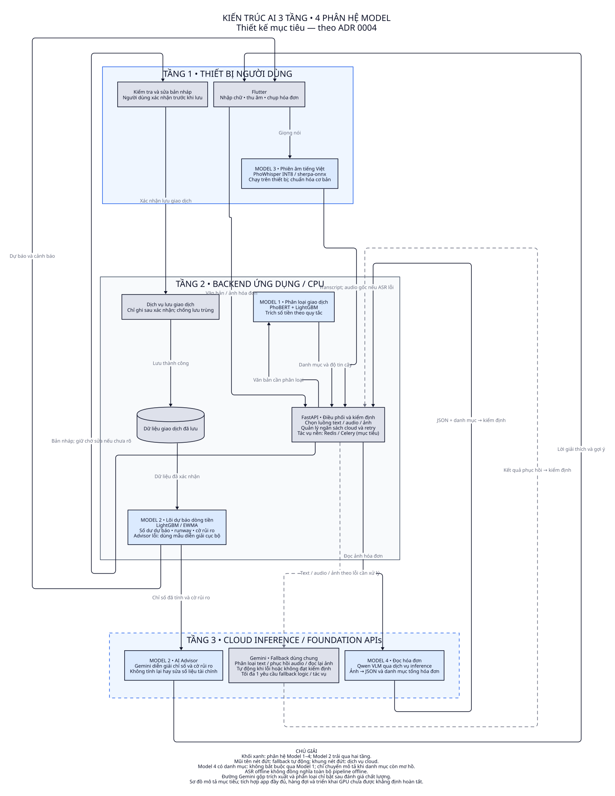

# Sơ đồ kiến trúc AI

| Sơ đồ | Các khối | Dịch vụ cloud | Cập nhật |
|---|---|---|---|
| [Kiến trúc AI 3 tầng](ai-three-tier.svg) | Thiết bị, backend CPU, cloud; phân bố Model 1–4 | Qwen inference, Gemini | 2026-10-19 |



[Ảnh PNG](ai-three-tier.png) · [Nguồn D2](ai-three-tier.d2)

Đây là hình minh họa kiến trúc mục tiêu theo [ADR 0004](../../adr/0004-three-tier-ai-and-modality-fallback.md), không phải đặc tả mới hay xác nhận toàn bộ kiến trúc đã được triển khai. Các quyết định và thuật ngữ tiếp tục lấy từ ADR và GLOSSARY gốc.

| Phân hệ | Vị trí | Trách nhiệm |
|---|---|---|
| Model 1 | Tầng 2 | PhoBERT + LightGBM phân loại văn bản; trích tiền theo quy tắc. |
| Model 2 | Tầng 2 và tầng 3 | Lõi LightGBM/EWMA tính dự báo; Gemini Advisor chỉ diễn giải chỉ số đã tính. |
| Model 3 | Tầng 1 | PhoWhisper phiên âm; transcript dùng được qua chuẩn hóa và Model 1. |
| Model 4 | Tầng 3 | Qwen đọc ảnh thành JSON và danh mục tổng hóa đơn; chỉ nhờ Model 1 khi danh mục còn mơ hồ. |

Các mũi tên biểu diễn trao đổi nghiệp vụ, không mô tả đầy đủ từng bước của giao thức. Kết quả AI phải qua kiểm định; bản nháp cần người dùng xác nhận trước khi lưu. Chỉ sau khi lưu thành công, dữ liệu mới phục vụ cập nhật dự báo.

Fallback được điều phối tự động theo tác vụ lỗi: text cho phân loại, audio gốc khi phiên âm lỗi, ảnh gốc khi đọc hóa đơn lỗi. Ngân sách mặc định là một yêu cầu Gemini fallback logic cho mỗi tác vụ nhập liệu; Advisor có tác vụ và ngân sách riêng. Transcript phục hồi vẫn qua classifier cục bộ. Đường media gộp trích xuất và danh mục chỉ bật sau đánh giá chất lượng; nếu chưa giải quyết được thì giữ bản nháp cần kiểm tra.

Render SVG và PNG bằng:

```powershell
node C:/Users/PC/.agents/skills/d2-activity/render.mjs docs/_shared/d2-architect/ai-three-tier.d2 --png
```
